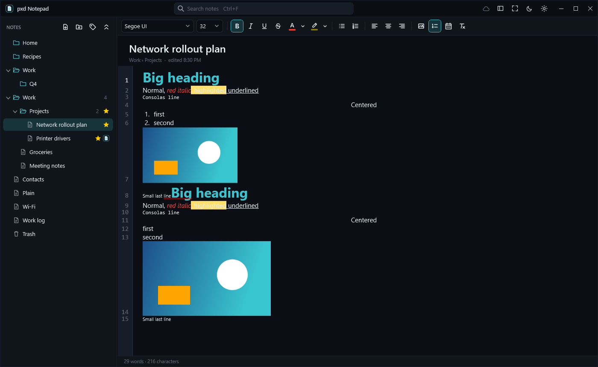
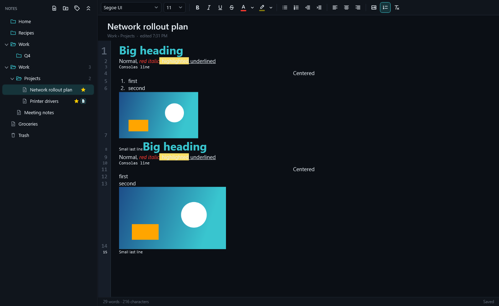
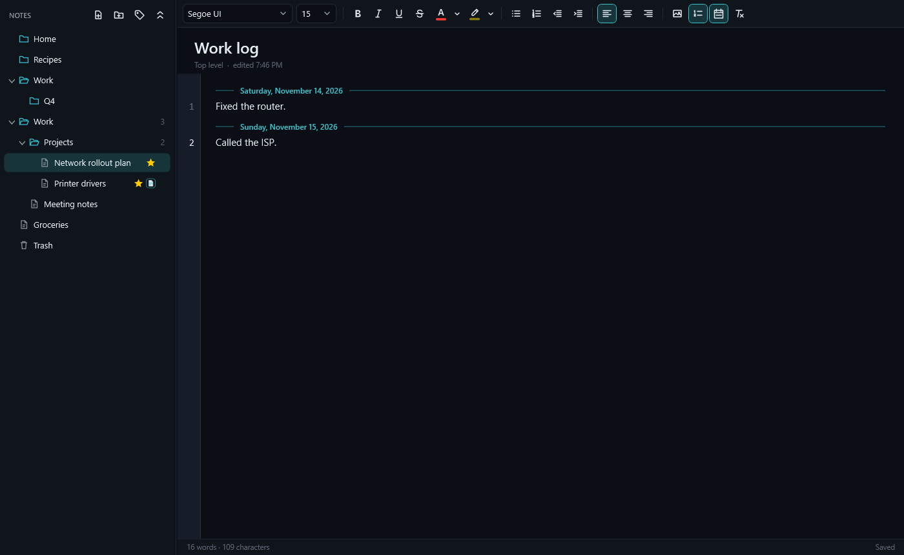
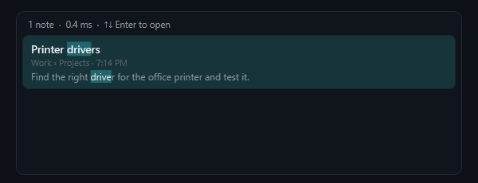
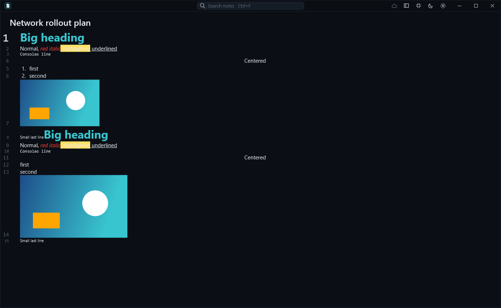
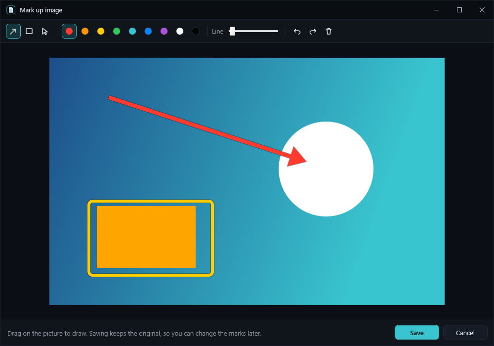
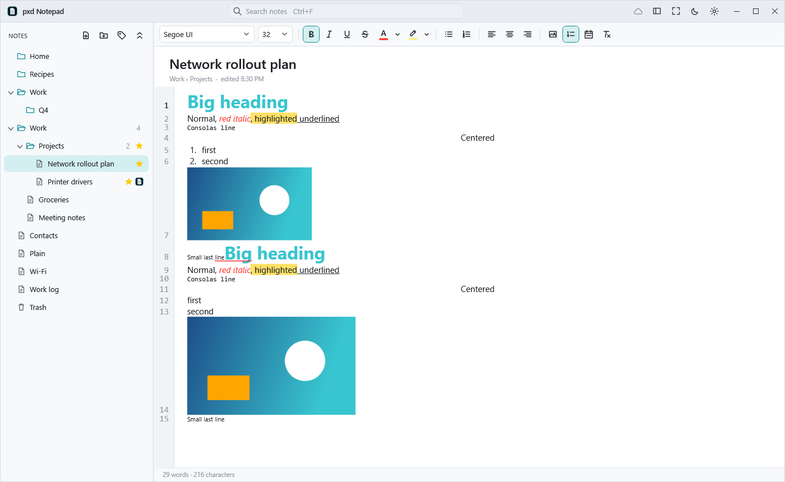

# pxd Notepad

A light, fast notes app for Windows: instant search from the title bar, folders inside folders, rich text (fonts,
sizes, colours, highlight, lists), pictures you can resize and mark up with arrows and boxes, line numbers that match
each line's size, a distraction-free writing mode, dark and light themes, and encrypted sync between your PCs.



## What it does

- **Search as you type, right in the title bar.** Every 3+ letter piece of a word is in a trigram index (SQLite FTS5),
  so `zanzib` finds *zanzibar* in 20,000 notes in about 2 ms. Results drop down under the box with the matches
  highlighted; opening one selects the match in the note. `Ctrl+F` to search, `↑` `↓` `Enter` to pick, `Esc` to clear.
- **Folders, like a file tree:** folders inside folders, as deep as you like, each with its notes inside. Click a
  folder to open or close it. Drag notes and folders to move them. Deleting a folder never deletes notes: they move up a
  level. Trash keeps deleted notes until you empty it.
- **Writing mode** (`F11`): everything but the page goes away and the title bar slims down. `Ctrl+\` hides just the
  notes list. In writing mode the window goes down to 300 × 150, a sticky note on the side of the screen (560 × 360
  otherwise); the title bar gives up its less-used buttons as it narrows. Writing mode and normal mode each remember
  their own size, position and maximized state, so F11 jumps between your two layouts in one move. The pin in
  writing mode's title bar keeps it on top of other windows, like a sticky note.
- **Date each day's entries** (per note, off until you turn it on: the calendar button on the toolbar, or right-click
  the note): for running logs. The first thing you write on a new day gets a line across with the day's date above it.
  Editing older text doesn't add one. Dates are searchable (`2026-11-15` or the written-out date).
- **Rich text, per part of a note:** font, size, colour, highlight, bold, italic, underline, strikethrough, bulleted
  and numbered lists, alignment and indent. Select text and pick, or pick first and type.
- **Tags with icons:** make tags once (the tag button above the notes list): a name plus either one of 30 built-in
  symbols in a colour of your choice or any `.ico` / `.png` file. Right-click a note or a folder → *Tags* to put them on
  or take them off; each shows its tags' icons at the right end of its row. Search a tag's name (or `#name`) to list
  every folder and note that has it (folders first; a folder's name finds it too).
- **Clickable phone numbers, emails and web links:** found as you type and underlined (nothing is stored in the
  note). Click an email to write to it, a web link to open it, a phone number to call it with your calling app (the
  app Windows uses for `tel:` links, e.g. RingCentral) after a phone-style Call / Cancel screen. Ctrl+click to edit one; right-click to
  copy it.
- **Blur** (select text → right-click → *Blur*, or `Ctrl+Shift+B`): for a password you need for a moment. It shows
  smeared, but copying it gives the real text. Blurred text is left out of search, previews and tooltips (shown as
  ••••••), stays blurred after a restart and on synced PCs. Right-click → *Unblur* to show it again.
- **Line numbers** (`Ctrl+Shift+L`): in their own shaded strip, all at the note's normal size and each on its line's
  baseline (a big heading just leaves space above its number). Settings → Text can make each number match its
  line's text size instead. Wrapped lines keep one number.
- **Pictures:** paste a screenshot, drop or insert a file. Drag the corner to resize (it keeps its shape);
  right-click for actual size, half size or fit to the page.
- **Mark-up:** double-click a picture to draw arrows and boxes on it, in any colour and thickness (Shift for a square;
  move or delete marks later). The original is kept, so marks can always be changed or removed.
- **Dark and light** themes, switched from the title bar.
- **Sync** (Settings → Sync): notes, folders and pictures stay the same on every PC. Everything is encrypted on the
  PC with your own sync key (AES-256-GCM) before it's sent, so the server only stores data it can't read. If the same
  note is changed on two PCs, the newer edit wins.













## Keys

| Keys | Does |
|---|---|
| `Ctrl+N` | New note in the selected folder |
| `Ctrl+Shift+N` | New folder |
| `Ctrl+F` | Search |
| `F11` | Writing mode on/off |
| `Ctrl+\` | Notes list on/off |
| `Ctrl+B` / `I` / `U` | Bold / italic / underline |
| `Ctrl+]` / `Ctrl+[` | Bigger / smaller text |
| `Ctrl+Shift+L` | Line numbers on/off |
| `Ctrl+S` | Save now (it also saves by itself as you type) |
| `F2` / `Del` in the notes list | Rename / delete (notes go to Trash) |

## Sync

The first PC turns sync on with a one-time invite code from whoever runs the server. That creates your vault and a
sync key. Every other PC joins with the sync key (Settings → Sync → *I have a sync key*). Keep the key somewhere safe:
anyone with it can read your notes, and without it they can't be recovered.

The default server is `https://pxdtek.com` (its `/n/v1` API keeps each vault's encrypted records and images). Any server
that speaks the same API can be used instead.

## Where things are

- App: `%USERPROFILE%\Apps\pxdNotepad`
- Notes: `%APPDATA%\pxdNotepad\notes.db` (SQLite), settings in `settings.json` and window placement in `windows.json`
  next to it. The sync key is kept encrypted for your Windows account (DPAPI).

## Building

.NET 10 SDK, Windows.

```
dotnet publish -c Release -o dist
dist\pxdNotepad.exe --self-test <out-folder>
```

The self-test checks storage, search speed, the note format, the folder tree, line numbers, images, mark-up, writing
mode and encryption, and draws the window to PNG files in the out folder. Nothing appears on screen. Set
`PXDNOTEPAD_TEST_SERVER` and `PXDNOTEPAD_TEST_INVITE` to also run two copies syncing through a sync server.

Built with WPF (its rich-text editor is what makes mixed fonts, inline pictures and per-line number sizes possible)
and SQLite. Follows the pxd App Standard: own title bar, remembered window, single instance, self-update from GitHub
releases.
